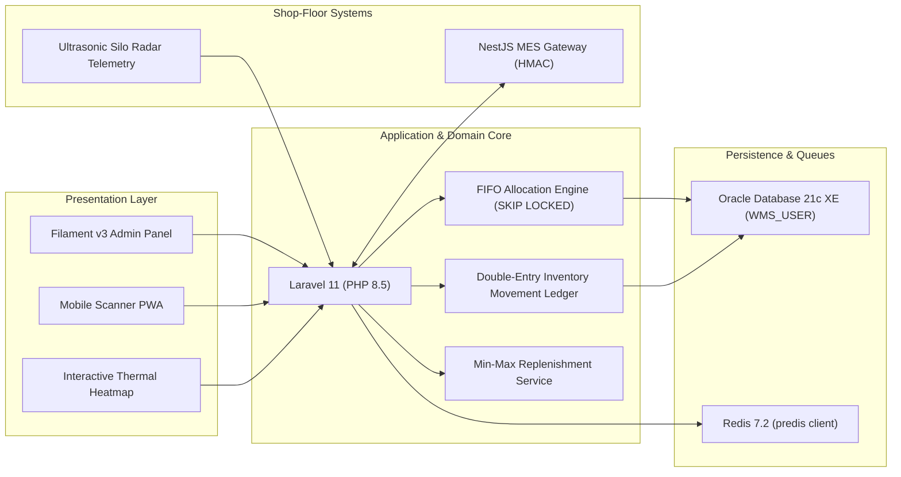

# Smart WMS — Warehouse Management System for Discrete Manufacturing

<p align="center">
  
</p>

<p align="center">
  
  
  
  
  
  
</p>

**Smart WMS** is an enterprise-grade Warehouse Management System built with **Laravel 11**, **Filament v3**, and **Oracle Database 21c XE**. Designed specifically for discrete plastic injection molding facilities, it governs raw material logistics (polymers, masterbatch, regrind, additives), staging hoppers, and finished goods fulfillment while integrating with shop-floor Manufacturing Execution Systems (MES).

---

## Table of Contents

- [Core Domain Modules](#core-domain-modules)
- [Architecture & Tech Stack](#architecture--tech-stack)
- [Prerequisites & Environment](#prerequisites--environment)
- [Quick Start Installation](#quick-start-installation)
- [Default Login Credentials](#default-login-credentials)
- [Background Daemons & Queue Workers](#background-daemons--queue-workers)
- [Verification & Invariant Auditing](#verification--invariant-auditing)
- [CLI Reference](#cli-reference)
- [License](#license)

---

## Core Domain Modules

### 1. Inbound Dock Logistics & QA Hold Gates
* **PO Receiving:** Inbound scanning against Purchase Orders with vendor heat numbers, Certificate of Analysis (COA), and Melt Flow Index (MFI) metadata.
* **Barcode & QR Generation:** Automatic GS1 Code-128 and DataMatrix labeling for pallets, bulk octabins, and 25 kg bags.
* **QA Quarantine Status:** Received resin defaults to `QA_HOLD`; only authorized QA personnel can release lots to `AVAILABLE` or reject to `QUARANTINE`.

### 2. High-Concurrency FIFO Lot Allocation & Blend Cap
* **FIFO by Timestamp:** Prioritizes candidate inventory balances by `material_lots.received_at` with stable balance-ID tie-breakers.
* **Non-Blocking `SKIP LOCKED` Concurrency:** Built with Oracle 21c `SELECT ... FOR UPDATE OF inventory_balances.id SKIP LOCKED` fast path with automatic contention fallback, eliminating picker thread convoying during concurrent picking waves.
* **Regrind Blend-Cap Preservation:** Automatically allocates in-house regrind lots first up to the product's `max_regrind_percentage`, satisfying the remainder from virgin resin while strictly prohibiting generation-2+ recycled material.

### 3. Dynamic Forward-Pick Face Replenishment
* **Min-Max Deficit Engine:** Periodically scans forward-pick faces, computes stock deficits against safety minimums, and generates forklift replenishment missions.
* **Dual-Bin Execution:** Automatically reserves bulk storage pallets and transfers material with full double-entry ledger debit/credit postings upon driver scan confirmation.

### 4. Wave & Batch Picking with S-Path Routing
* **Serpentine (S-Path) Optimization:** Sorts picking tasks across warehouse aisles (odd aisles ascending, even aisles descending), eliminating wasted reach-truck backtracking.
* **Multi-Tote Batching:** Groups production staging orders into unified picker batches with tote assignment.

### 5. Interactive Thermal Warehouse Heatmap
* **Full-Facility SVG Topography:** Visualizes zones, aisles, racks, and bins with dynamic color-coded thermal gradients reflecting fill-rate percentage, weight limits, and blocked states.
* **Deep Inspection:** Slide-over drawer providing bin-level lot inspection, active balances, and one-click toggle to block/unblock damaged storage locations.

### 6. Outdoor Bulk Silo Telemetry & Auto-Requisition
* **Geometric Volume Computation:** Accurately models composite cylindrical and conical hopper geometries based on resin bulk density ($\text{g/cm}^3$).
* **Sensor Ingestion:** Ingests radar/ultrasonic level readings via authenticated REST API (`X-Telemetry-Key`) and automatically triggers draft Purchase Requisitions when stock falls below critical thresholds.

### 7. Traceability, Genealogy & Security Gate Pass
* **Bi-Directional Recall Trees:**
  * *Backward Trace:* Traces finished goods cartons back to raw resin lot numbers, vendor heat numbers, machine operator, and molding station.
  * *Forward Trace:* Instantly maps a contaminated resin batch to all finished goods cartons and customer Delivery Orders (DO).
* **Mass Quarantine:** Locks connected lots across the supply chain in a single atomic transaction.
* **SSCC-18 Pallet Labeling & Security Gate Clearance:** Generates Serial Shipping Container Codes with Modulo-10 checksums and electronic Gate Pass clearance with vehicle/driver verification.

### 8. Stock Opname (Blind Cycle Counting)
* **Zero-Knowledge Auditing:** Mobile counters submit blind physical counts without seeing digital expected figures.
* **Variance Approval & Ledger Posting:** Supervisors review delta calculations and approve atomic double-entry balance adjustments.

### 9. Mobile Scanner PWA
* **Rugged Terminal Optimization:** Designed for handheld mobile barcode terminals (Zebra TC26, Honeywell EDA51) supporting hardware keyboard-wedge and camera scanning across all 8 warehouse modes: Receiving, Putaway, Picking, Staging, Regrind, Cycle Count, Shipping, and Returns.

### 10. Live MES Integration Gateway
* **HMAC SHA-256 Webhooks:** Validates cryptographically signed payloads from the companion NestJS MES for packaging handover and finished goods carton intake.
* **Outbox Dispatcher:** Asynchronously processes pending raw material lot issuances to MES without blocking warehouse HTTP threads.

---

## Architecture & Tech Stack



- **Backend Framework:** Laravel 11.57.x on PHP 8.3+ (PHP 8.5 tested)
- **Administrative Portal:** Filament PHP v3
- **Primary Database:** Oracle Database 21c Express Edition (via `yajra/laravel-oci8`)
- **Queue & Cache Backend:** Redis 7.2 (via `predis/predis`)
- **Frontend Interactivity:** Livewire v3, Alpine.js, Tailwind CSS
- **Code Standards:** PSR-12, Laravel Pint strict enforcement

---

## Prerequisites & Environment

1. **PHP 8.3+** with extensions: `ext-oci8`, `ext-pdo`, `ext-intl`, `ext-bcmath`, `ext-gd`, `ext-zip`.
2. **Oracle Database 21c XE** running locally (Docker container `oracle-xe` on port `1521`, service name `XEPDB1`).
3. **Oracle Instant Client** installed with environment variables exported:
   ```bash
   export ORACLE_HOME=/home/ughway/.oracle-client
   export LD_LIBRARY_PATH=/home/ughway/.oracle-client/lib${LD_LIBRARY_PATH:+:$LD_LIBRARY_PATH}
   export PHP_INI_SCAN_DIR=:/home/ughway/.oracle-client
   ```
4. **Redis 7.2** listening on `127.0.0.1:6379`.
5. **Composer 2.x** and **Node.js 20+** / NPM.

---

## Quick Start Installation

### 1. Clone & Dependencies
```bash
git clone https://github.com/your-org/warehouse-management-system.git
cd warehouse-management-system

# Install PHP packages
composer install

# Install & compile frontend assets
npm install && npm run build
```

### 2. Environment Configuration
Copy `.env.example` to `.env` and verify Oracle and Redis connection credentials:
```bash
cp .env.example .env
php artisan key:generate
```

Ensure `.env` matches your local database setup:
```dotenv
DB_CONNECTION=oracle
DB_HOST=127.0.0.1
DB_PORT=1521
DB_DATABASE=XEPDB1
DB_SERVICE_NAME=XEPDB1
DB_USERNAME=WMS_USER
DB_PASSWORD=YourPasswordHere
DB_CHARSET=AL32UTF8
DB_SERVER_VERSION=21c

QUEUE_CONNECTION=redis
REDIS_CLIENT=predis
REDIS_HOST=127.0.0.1
REDIS_PORT=6379
REDIS_DB=0
REDIS_CACHE_DB=1
```

### 3. Database Migration & Seed
Run migrations and populate warehouse topology, master catalog, and operational demo data:
```bash
php artisan migrate:fresh --seed
```

### 4. Start the Application
Start background workers and the local development web server:
```bash
# Start background queue workers & scheduler daemon
./scripts/wms-daemon.sh start

# Start Laravel development server
php artisan serve --port=8001
```

Access the application in your browser:
* **Admin Portal:** `http://localhost:8001/admin`
* **Mobile Scanner UI:** `http://localhost:8001/scanner`

---

## Default Login Credentials

Seeded automatically by [`RoleAndPermissionSeeder.php`](file:///home/ughway/Debiancode/Myprojects/Warehouse-Management-System/database/seeders/RoleAndPermissionSeeder.php):

| Role | Email | Password | Access Scope |
| :--- | :--- | :--- | :--- |
| **Warehouse Manager** | `admin@wms.local` | `password` | Full administrative oversight, approvals, analytics, and settings |
| **QA Inspector Lead** | `qa@wms.local` | `password` | Quality inspection, QA hold releases, quarantine dispositions |
| **Shop Floor Handler** | `handler@wms.local` | `password` | Mobile scanner terminal, picking, staging, and replenishment |

---

## Background Daemons & Queue Workers

### Development Environment
Use the built-in daemon supervisor script:
```bash
./scripts/wms-daemon.sh start    # Start Redis queue worker & scheduler
./scripts/wms-daemon.sh status   # Check process health and PIDs
./scripts/wms-daemon.sh stop     # Gracefully terminate daemons
./scripts/wms-daemon.sh restart  # Restart workers
```
Logs are stored in `storage/logs/wms-queue-worker.log` and `storage/logs/wms-scheduler.log`.

### Production Environment (systemd)
Deploy the pre-configured systemd unit templates located in [`deploy/systemd/`](file:///home/ughway/Debiancode/Myprojects/Warehouse-Management-System/deploy/systemd/):
```bash
# Copy unit files
sudo cp deploy/systemd/wms-worker@.service /etc/systemd/system/
sudo cp deploy/systemd/wms-scheduler.service /etc/systemd/system/
sudo cp deploy/systemd/wms-scheduler.timer /etc/systemd/system/

# Reload and enable multi-worker instances (e.g. 2 workers)
sudo systemctl daemon-reload
sudo systemctl enable --now wms-worker@1.service
sudo systemctl enable --now wms-worker@2.service
sudo systemctl enable --now wms-scheduler.timer
```

---

## Verification & Invariant Auditing

### 1. Pre-Go-Live Invariant Auditor
Run the standalone mathematical integrity script:
```bash
./scripts/verify-inventory-invariants.php
```
Asserts **8 core mathematical invariants**:
1. Non-negative `quantity_on_hand` across all records.
2. Non-negative `quantity_reserved`.
3. Zero over-reservation (`quantity_reserved <= quantity_on_hand`).
4. Non-negative available stock (`quantity_on_hand - quantity_reserved >= 0`).
5. **Conservation of Mass:** $\sum \text{On-Hand} \equiv \sum \text{Net Ledger Debits/Credits}$.
6. Auditable `received_at` timestamps on all available lots.
7. Regrind recycling ceiling enforced (`regrind_generation <= 2`).
8. Warehouse bin structural weight capacity ceilings.

### 2. Concurrency Load Benchmark
Measure transaction latency and verify zero `ORA-00060` deadlocks under load:
```bash
# Benchmark 25 concurrent pickers allocating 10 KG each
php artisan wms:benchmark-allocation --workers=25 --requests=4 --sku=RAW-PP-INJ-503 --release
```

### 3. Automated Test Suite
Execute the test suite against the live Oracle 21c XE container:
```bash
php artisan test
```
*Current test metrics:* **96 tests, 676 assertions, 100% pass rate**.

### 4. Code Style & PSR-12 Conformance
```bash
./vendor/bin/pint --test
```

---

## CLI Reference

| Command | Description |
| :--- | :--- |
| `php artisan wms:benchmark-allocation` | Benchmarks FIFO allocation latency percentiles under concurrent worker processes. |
| `php artisan wms:evaluate-replenishments` | Evaluates forward-pick bin deficits and generates automated replenishment tasks. |
| `php artisan wms:sync-mes-outbox` | Dispatches pending raw material lot issuance events to the companion NestJS MES. |
| `./scripts/verify-inventory-invariants.php` | Audits database records for zero negative inventory, mass conservation, and zero drift. |
| `./scripts/wms-daemon.sh {start\|stop\|status}` | Manages local Redis queue workers and scheduler background processes. |

---

## License

This project is proprietary enterprise software developed for discrete injection molding logistics operations. All rights reserved.
